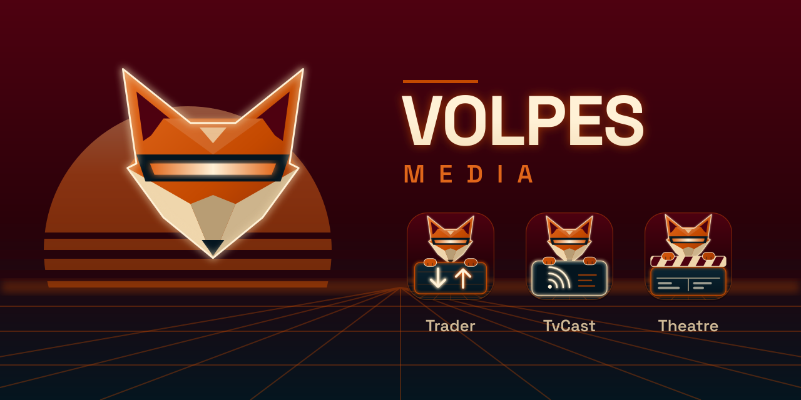

<p align="center"></p>

<p align="center"><b>Media apps for the Linux desktop, made to work together.</b><br>
Watch on your computer, send it to your TV, and download what you want to watch.</p>

---

## What Volpes-Media makes

Volpes-Media is a small family of apps for Linux, built with GTK 4 and libadwaita so they look at home on GNOME, Zorin OS and Ubuntu. Each app does one job well, and they work together: a film you start in one carries on in another at the same second, with the same subtitles and the rest of the playlist.

<table>
<tr>
<td width="96" align="center"></td>
<td>
<h3>Theatre</h3>
A video player for people who love films more than settings. Open a film or a whole season and it plays, with subtitles, in a dark room of its own.
<ul>
<li>Plays nearly any video (MKV, MP4, AVI, WebM…) on the graphics card, cool and quiet</li>
<li>Chapters on the progress line, and <b>Skip Intro</b>, <b>Skip Recap</b> and <b>Skip Credits</b>, even when episodes have no named chapters</li>
<li>Opens a whole folder as a playlist and picks up where you left off in every episode</li>
<li>Subtitles your way: size, colour, outline or box, and the language you prefer</li>
<li>One key (<kbd>C</kbd>) sends the film to your TV; <b>Watch Here</b> brings it back</li>
</ul>
</td>
</tr>
<tr>
<td width="96" align="center"></td>
<td>
<h3>TvCast</h3>
Cast videos with subtitles, or mirror your screen, from Linux to your TV.
<ul>
<li>Chromecasts and DLNA smart TVs (Samsung, LG, Sony, Philips…)</li>
<li>Subtitles from files or built into MKV and MP4</li>
<li>Converts on the fly when the TV can't play a file, using the graphics card when there is one</li>
<li>Mirror one window or the whole screen, with sound</li>
<li>Lives in the top bar, ready to cast</li>
</ul>
</td>
</tr>
<tr>
<td width="96" align="center"></td>
<td>
<h3>BitTrader</h3>
Download and seed torrents, and keep seeding from the top bar.
<ul>
<li>Torrent files and magnet links, from the window, your browser or Files</li>
<li>Keeps seeding with the window closed, in about 16 MB of memory</li>
<li>Pick which files to download, move a torrent to another disk without downloading again</li>
<li>Imports your torrents from Transmission, qBittorrent and Fragments</li>
</ul>
</td>
</tr>
</table>

### How they fit together

- **Theatre → TV:** press **Cast** in Theatre and TvCast plays the film on your TV from the same moment. Theatre turns into a remote control with a picture of what's on the TV.
- **TV → Theatre:** **Watch Here** in Theatre, or **Watch in Theatre** in TvCast's top-bar menu, and it comes back to your computer.
- **One shared place per video:** stop on the TV, carry on in Theatre, or the other way round.

## Install

All three apps come from the Volpes-Media apt repository, so new versions arrive with your normal updates (`sudo apt upgrade` or the Software Updater), a few minutes after each release.

**Works on:** Zorin OS 18, Ubuntu 24.04 or newer, Linux Mint 22 or newer, and Debian 13 or newer, on 64-bit PCs (amd64).

**1. Add the repository** (once):

```bash
sudo install -d -m 0755 /etc/apt/keyrings
sudo wget -qO /etc/apt/keyrings/volpesmedia.gpg https://volpesmedia.github.io/apt/volpesmedia.gpg
sudo wget -qO /etc/apt/sources.list.d/volpesmedia.sources https://volpesmedia.github.io/apt/volpesmedia.sources
sudo apt update
```

**2. Install Theatre:**

```bash
sudo apt install theatre
```

Want to watch on your TV as well? Add TvCast, and BitTrader if you like:

```bash
sudo apt install theatre tvcast bittrader
```

Then open them from your app grid.

<details>
<summary>About the signing key, and removing the repository</summary>

<br>

Every update is signed. The key's fingerprint is:

```
AB9E FDAD BAD8 571D FC20  DC82 457D E12A 62F3 AD84
```

Your system trusts this key only for the Volpes-Media repository (`Signed-By` in the `.sources` file), never for anything else.

To go back an app to an earlier version: `sudo apt install theatre=<version>` (the last three versions of each app are kept).

To remove the repository:

```bash
sudo rm /etc/apt/sources.list.d/volpesmedia.sources /etc/apt/keyrings/volpesmedia.gpg && sudo apt update
```

</details>

More at **[volpesmedia.github.io/apt](https://volpesmedia.github.io/apt/)** and in the **[apt](https://github.com/volpesmedia/apt)** repository.

## What's in this organisation

| Repository | What it is |
|---|---|
| **theatre** | The Theatre video player |
| **tvcast** | TvCast, casting and screen mirroring |
| **trader-bittorrent-client** | BitTrader, the torrent app |
| **[apt](https://github.com/volpesmedia/apt)** | The apt repository that delivers all three apps |
| **api** | The D-Bus API (`io.github.volpesmedia.Api1`) the apps use to hand a video to each other |
| **volpes-design-system** | Colours, type, icons and GTK styles shared by every app |

<p align="center"><sub>Volpes-Media · Theatre · TvCast · BitTrader</sub></p>
